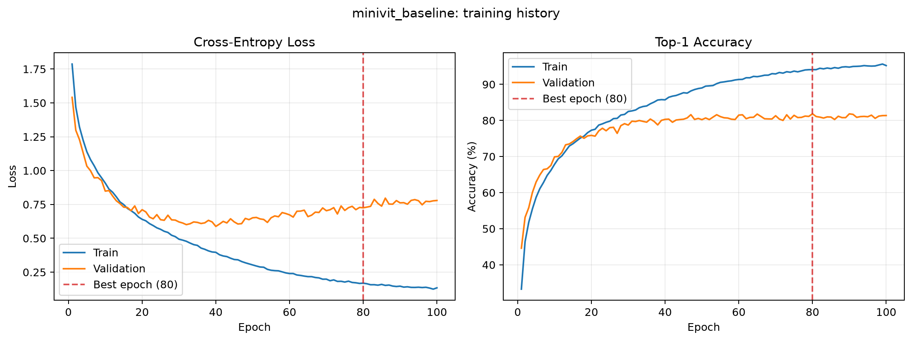
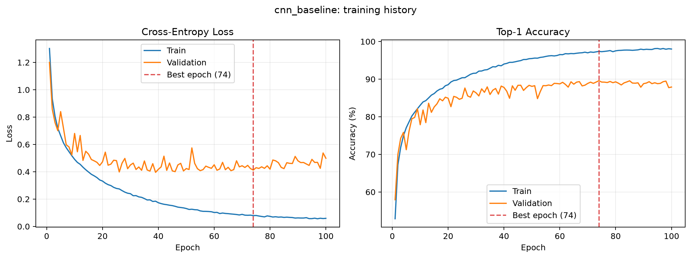
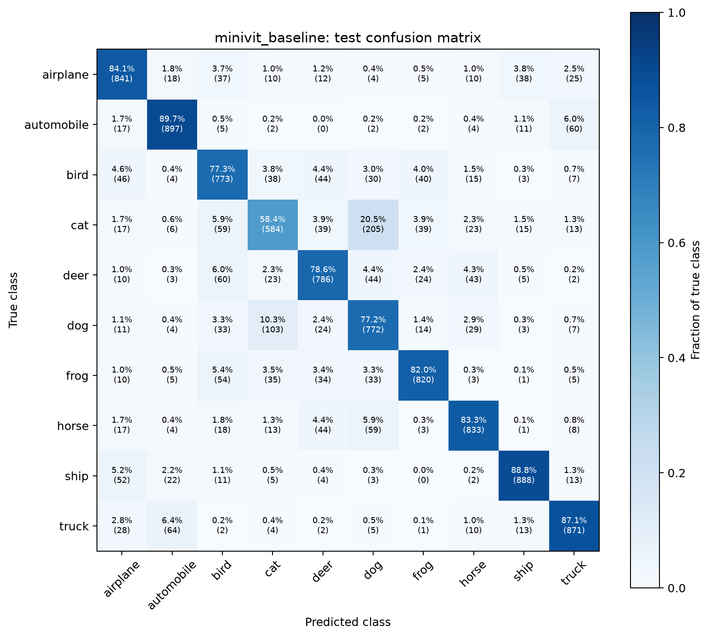
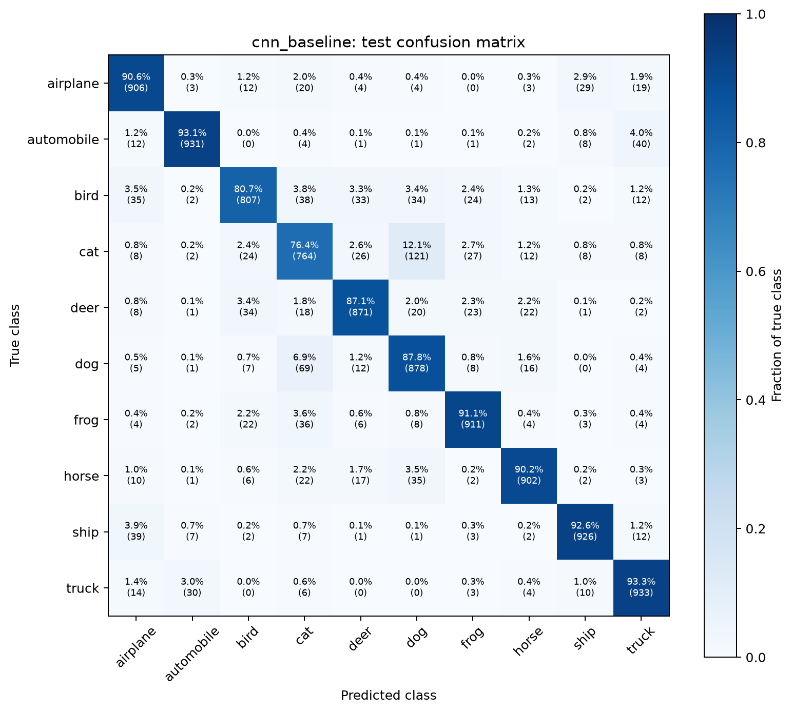
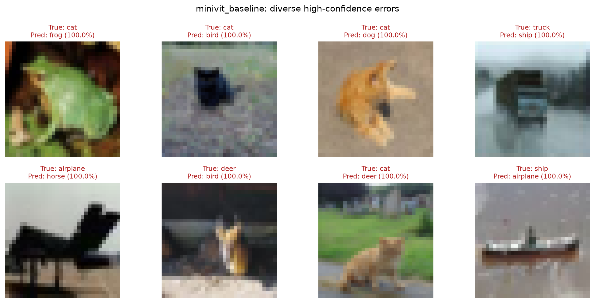
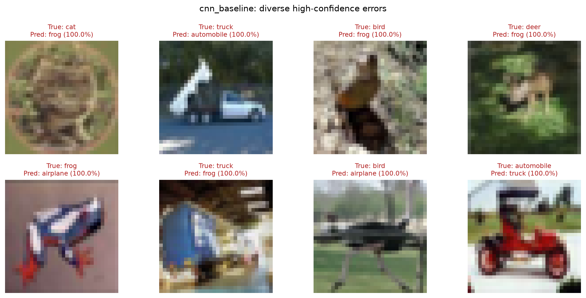
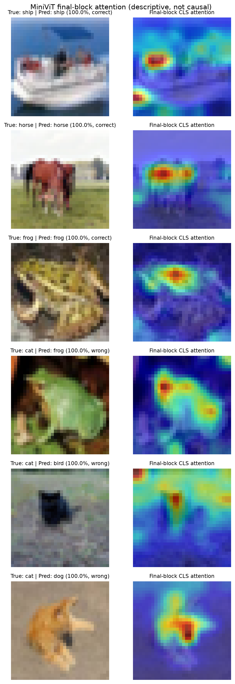

# Mini ViT：从零实现、实验分析与跨域迁移

这是一个面向学习与实验复现的 PyTorch 项目：从零实现 MiniViT 核心模块，在 CIFAR-10 上完成训练、CNN 对照、结构消融与训练策略研究，并进一步完成多 seed 评估、效率基准、图像扰动、CORe50 跨 session 迁移及 Attention Rollout。

项目强调的不是堆叠训练技巧或追求最高精度，而是建立一条正确、可运行、可解释、可测试、可复现的深度学习工程链路。

**项目状态：阶段 0–18 已完成，代码、轻量结果与文档已上传 GitHub。** 项目原创代码及文档采用 [MIT 许可证](LICENSE)；当前未创建 release。第三方材料的许可例外见下文。

冻结的 advanced MiniViT 在 train seeds 42、123、2026 上的最终 CIFAR-10 clean test 分别为 86.38%、86.32%、86.08%，均值 ± 样本标准差为 **86.260 ± 0.159%**（同一测试集，非置信区间）。评估协议、版本与哈希见 [阶段 18 笔记](notes/STAGE_18_NOTES.md)及[结构化结果](assets/advanced/stage18/clean_test_summary.json)。

项目材料：[最终实验报告](notes/FINAL_EXPERIMENT_REPORT.md) · [复现指南与资源预算](notes/REPRODUCTION_GUIDE.md) · [项目介绍与技术提纲](notes/PROJECT_PRESENTATION.md)。完整数据集和 checkpoint 不随 Git 仓库分发。独立新环境的安装、冒烟、推理及 479 项测试已通过；阶段 18 于 2026-10-11 完成验收，项目所有者接受基础旧评估缺原运行 commit 的历史例外，相关结果仅作为带限制的历史参照。

快速导航：[基础结果](#基础项目最终结果) · [进阶结果](#进阶实验结果) · [模型结构](#模型结构) · [快速开始](#快速开始) · [单图推理](#单图推理与-attention-rollout) · [学习笔记](#学习笔记与项目材料)

## 项目亮点

- 从零实现 MiniViT 核心结构，不依赖 `torchvision.models` 中的现成 ViT。
- 固定随机种子，将 CIFAR-10 官方训练集划分为 45,000 张训练图片和 5,000 张验证图片。
- 使用同一训练引擎比较 MiniViT 与参数量相近的 SimpleCNN。
- 完成 Patch Size、Encoder Depth、Data Augmentation 三组单变量消融实验。
- 支持 YAML 配置、逐 epoch 日志、最佳/最新 checkpoint 和断点续训，以及 warmup/cosine、梯度裁剪与 AMP。
- 对 Label Smoothing、Mixup、CutMix 做对照，并用三个训练 seed 确认最终配方。
- 测量参数量、计算量、延迟、吞吐量和显存，完成扰动与迁移实验。
- 冻结模型后统一评估官方 10,000 张测试图片，并保存逐样本预测。
- 生成训练曲线、混淆矩阵、错误案例、末层 CLS Attention 与跨层 Rollout，并提供单图推理 CLI。
- 使用 pytest 覆盖数据、模型 shape/梯度、tiny overfit、训练引擎、评估入口和可视化契约。

## 基础项目最终结果

下表中的基础模型与消融实验都训练 100 epoch，并根据验证准确率选择唯一的 `best.pt`。模型与配置全部冻结后，才在 CIFAR-10 官方测试集上进行完整评估；测试结果没有用于重新调参。

| 模型 / 实验 | 参数量 | Best Val Acc | Best Epoch | Test Loss | Test Acc |
|---|---:|---:|---:|---:|---:|
| SimpleCNN baseline | 2,609,002 | **89.58%** | 74 | **0.4514** | **88.29%** |
| MiniViT baseline（p4 / d6 / aug） | 2,693,578 | 81.84% | 80 | 0.7335 | 80.65% |
| MiniViT depth 9 | 4,028,170 | 81.46% | 96 | 0.8347 | 80.36% |
| MiniViT depth 3 | 1,358,986 | 81.16% | 95 | 0.7347 | 80.27% |
| MiniViT patch 2 | 2,723,530 | 80.02% | 51 | 0.7653 | 78.94% |
| MiniViT patch 8 | 2,712,010 | 77.30% | 76 | 0.8077 | 76.38% |
| MiniViT no augmentation | 2,693,578 | 72.64% | 94 | 1.5201 | 70.93% |

详细的训练指标、实验条件、耗时和 checkpoint SHA-256 见 [实验结果总账](notes/EXPERIMENT_RESULTS.md)。

## 基础实验结论

### MiniViT 与 CNN

基础 CNN 的测试准确率比基础 MiniViT 高 7.64 个百分点。历史训练的平均 epoch 耗时约为 10.75 秒与 25.64 秒，不是其他设备上的耗时承诺。在当前 32×32 小图像、45,000 张训练图片和基础增强协议下，CNN 的优势与其局部性、权重共享等归纳偏置相符，但这个对照没有单独分离这些因素的因果贡献。

这不是“CNN 永远优于 ViT”的结论，而是说明基础 ViT 在小数据训练中更依赖充分数据、正则化和优化策略。

### Patch Size

测试准确率排序为：

```text
patch 4（80.65%）> patch 2（78.94%）> patch 8（76.38%）
```

Patch 2 使用更细的分块，但产生 256 个图像 token，注意力计算成本显著增加；Patch 8 只有 16 个图像 token，历史训练最快。Patch 4 在本次实验中精度最高；较粗分块可能丢失局部信息，但准确率差异不能仅归因于这一因素。各配置只有 seed 42，不代表稳定的普遍排序。

### Encoder Depth

Depth 3、6、9 的测试准确率分别为 80.27%、80.65%、80.36%。增加到 9 层没有带来可见收益；3 层以约一半参数量得到非常接近的结果。由于每个配置只运行 seed 42，微小差异可能包含随机波动，因此只能说“当前协议未观察到加深收益”。

### Data Augmentation

移除 RandomCrop 与 RandomHorizontalFlip 后，训练准确率更高，但测试准确率从 80.65% 降至 70.93%。这说明模型更容易记忆固定训练图片，却显著损失了对未见数据的泛化能力；基础数据增强是当前 MiniViT 的关键正则化来源。

## 进阶实验结果

进阶实验保持 MiniViT 的推理结构不变，增加优化、正则化、多 seed、效率、扰动和迁移证据。主要结果如下，不同任务与 split 的指标不能混用：

| 问题 | 结果 | 结论边界 |
|---|---|---|
| CutMix 对 R0 的三 seed validation 改善 | +2.947 ± 0.510 pp | 配对提升，未做显著性检验 |
| 冻结配方的三 seed clean test | 86.260 ± 0.159% | 同一个测试集；CNN 仍更高 |
| AMP 训练效率 | 约 1.455× 加速，allocated 峰值减少 26.47% | 当前硬件、计时协议与单 seed 对照 |
| 18 条扰动条件的 test macro | 进阶 ViT 69.01%，CNN 68.77% | 均为 seed 42；不同扰动优劣不同 |
| CORe50 test | Fine-tune 53.82%，Scratch 36.88% | 单 seed、同实例跨 session，不是新实例泛化 |

完整失败实验和协议见[最终报告](notes/FINAL_EXPERIMENT_REPORT.md)及[进阶总账](notes/ADVANCED_EXPERIMENT_RESULTS.md)。既有结果复核与新训练入口分开说明，避免覆盖冻结产物，详见[复现指南](notes/REPRODUCTION_GUIDE.md)。

## 模型结构

MiniViT baseline 的输入和张量变化：

```text
Image
[B, 3, 32, 32]
  │
  ▼
Patch Embedding: Conv2d(kernel=4, stride=4)
[B, 192, 8, 8]
  │ flatten + transpose
  ▼
Patch Tokens
[B, 64, 192]
  │ prepend learned CLS token
  ▼
Token Sequence
[B, 65, 192]
  │ add learned positional embedding
  ▼
6 × Pre-Norm Transformer Encoder Block
[B, 65, 192]
  │
  ▼
Final LayerNorm → take CLS token
[B, 192]
  │
  ▼
Linear Classifier
[B, 10] logits
```

每个 Encoder Block 使用 Pre-Norm 与残差连接：

```python
x = x + attention(norm1(x))
x = x + mlp(norm2(x))
```

baseline 配置：

| 参数 | 数值 |
|---|---:|
| Image Size | 32 |
| Patch Size | 4 |
| Image Tokens | 64 |
| Embedding Dimension | 192 |
| Encoder Depth | 6 |
| Attention Heads | 6 |
| Head Dimension | 32 |
| MLP Dimension | 768 |
| Dropout | 0.1 |
| Classes | 10 |

## 基础可视化结果

以下展示基础 MiniViT/CNN；进阶模型的末层 Attention、Rollout 与扰动案例见[阶段 17 对照图](assets/advanced/stage17/)。两类结果保持分开，避免混淆模型与实验协议。

### 训练过程

| MiniViT | SimpleCNN |
|---|---|
|  |  |

MiniViT 与 CNN 后期都出现训练准确率继续提高、验证 loss 上升的过拟合现象，但 CNN 的验证性能平台明显更高。

### 混淆矩阵

| MiniViT | SimpleCNN |
|---|---|
|  |  |

矩阵纵轴是真实类别，横轴是预测类别，并按真实类别做行归一化。两种模型都容易混淆外观接近的 `cat ↔ dog` 和 `automobile ↔ truck`。MiniViT 的 cat 类准确率为 58.4%，CNN 提高到 76.4%。

### 高置信错误案例

| MiniViT | SimpleCNN |
|---|---|
|  |  |

错误案例先按置信度排序，再优先覆盖不同的“真实类别 → 预测类别”组合，避免整张图只展示同一种错误。

### Attention 热力图



热力图取最后一个 Encoder Block 中 CLS query 指向 64 个 patch key 的注意力，对 6 个 head 求平均后恢复为 8×8 网格，并插值到 32×32。它只能描述该层如何分配注意力权重，不能证明高亮区域对预测具有因果作用。

## 项目结构

```text
Mini-ViT/
├── README.md
├── PROJECT_PLAN.md
├── requirements.txt
├── configs/
│   ├── minivit.yaml
│   ├── cnn.yaml
│   ├── ablations/             # 基础结构与增强消融
│   └── advanced/              # 阶段 10–18 的冻结协议与配方
├── notes/
│   ├── BASIC_PROJECT_WORKFLOW.md
│   ├── ADVANCED_PROJECT_WORKFLOW.md
│   ├── EXPERIMENT_RESULTS.md
│   ├── ADVANCED_EXPERIMENT_RESULTS.md
│   ├── ADVANCED_MINIVIT_FINAL.md
│   ├── DATASET_CARD.md
│   ├── FINAL_EXPERIMENT_REPORT.md
│   ├── REPRODUCTION_GUIDE.md
│   ├── PROJECT_PRESENTATION.md
│   └── STAGE_0_NOTES.md ... STAGE_18_NOTES.md
├── src/
│   ├── config.py
│   ├── data.py
│   ├── engine.py
│   ├── metrics.py
│   ├── utils.py
│   ├── visualization.py
│   ├── amp.py                 # 混合精度
│   ├── schedulers.py          # 学习率调度
│   ├── gradients.py           # 梯度统计与裁剪
│   ├── regularization.py      # Label Smoothing、Mixup、CutMix
│   ├── benchmarking.py        # 效率基准
│   ├── corruptions.py         # 确定性图像扰动
│   ├── core50.py              # 目标域数据管线
│   ├── transfer.py            # 迁移模型
│   ├── inference.py           # 共享推理接口
│   └── models/
│       ├── minivit.py
│       └── cnn.py
├── scripts/
│   ├── train.py
│   ├── evaluate.py
│   ├── visualize.py
│   ├── aggregate.py           # 多 run 汇总
│   ├── benchmark.py           # 效率测量
│   ├── robustness.py          # 扰动评估
│   ├── prepare_core50.py      # 目标域清单准备
│   ├── train_transfer.py      # 迁移训练
│   ├── evaluate_transfer.py   # 冻结迁移评估
│   ├── predict.py             # 单图推理
│   ├── visualize_rollout.py   # 固定 Rollout 案例
│   └── final_evaluation.py    # 阶段 18 冻结评估
├── tests/
├── assets/
├── data/       # Git ignored
└── outputs/    # Git ignored
```

代码职责：

- `src/`：可复用的数据、模型、训练、指标和绘图逻辑。
- `scripts/`：训练、最终评估和图表生成的命令行入口。
- `configs/`：模型、数据和训练超参数。
- `tests/`：自动化契约和回归测试。
- `notes/`：逐阶段学习笔记、工作流和实验总账。
- `outputs/`：本地 checkpoint、日志和逐样本预测，不提交 Git。
- `assets/`：用于报告和 README 的轻量图表。

## 环境要求

2026-10-11 原环境与独立新环境均验证通过：

```text
OS: Windows
Python: 3.14.0
PyTorch: 2.14.0+cu130
torchvision: 0.29.0+cu130
CUDA runtime reported by PyTorch: 13.0
GPU used for experiments: NVIDIA RTX 5060 Laptop GPU
```

完整直接依赖及固定版本见 [requirements.txt](requirements.txt)。当前 requirements 使用 PyTorch CUDA 13.0 wheel；若设备或平台不同，应根据 [PyTorch 官方安装说明](https://pytorch.org/get-started/locally/) 选择匹配版本，再安装其余依赖。

## 快速开始

以下命令在仓库根目录执行。只查看结果与图表不需要安装依赖；运行推理需要匹配的 checkpoint，运行训练需要数据。克隆仓库不会同时获得这两者。

### 1. 克隆仓库

```powershell
git clone https://github.com/XDkoala/Mini-ViT.git
cd Mini-ViT
```

### 2. 创建并激活虚拟环境

Windows PowerShell：

```powershell
py -3.14 -m venv .venv
.\.venv\Scripts\Activate.ps1
```

确认当前解释器：

```powershell
python -c "import sys; print(sys.executable)"
```

已有 `.venv` 时只需激活。若激活被 PowerShell 策略阻止，可直接用 `.\.venv\Scripts\python.exe` 替代后文的 `python`，无需修改全局执行策略。

### 3. 安装依赖

```powershell
python -m pip install --upgrade pip
python -m pip install -r requirements.txt
python -m pip check
```

### 4. 运行测试

```powershell
python -m pytest -q
```

2026-10-11 的最新回归为 **479 passed**，原环境与按 requirements.txt 安装的独立新环境均通过。新环境验证复用了本地数据和冻结权重，不等同于干净克隆后完成全部数据下载或长训练，详见[环境验收记录](assets/advanced/stage18/environment_acceptance.json)。

若系统临时目录有权限问题，可使用 `--basetemp outputs/readme_pytest_temp`；这是 pytest 专用临时目录，重复运行会清理其旧内容，不要指向权重或其他重要文件目录。

### 5. 数据准备

无需手工编写下载脚本。首次训练或评估时，`torchvision.datasets.CIFAR10` 会把数据下载到 `data/` 并解压。该目录已被 Git 忽略。

若网络下载中断，torchvision 的自动下载不保证断点续传；可以使用支持续传的工具下载 CIFAR-10 压缩包并放入 `data/`，再由 torchvision 完成校验和解压。

## 基础模型训练

以下复现命令使用独立目录，不覆盖历史 baseline。再次启动新实验时换一个未使用的目录；只有续训才复用原目录。进阶最终配方的三 seed 训练和 CORe50 准备/迁移命令见[复现指南](notes/REPRODUCTION_GUIDE.md#4-在独立目录启动新实验)。

### 隔离的冒烟训练

先使用少量 batch 验证数据、模型、训练、验证、日志和 checkpoint 链路。限制 batch 时必须指定独立输出目录，防止覆盖正式结果：

```powershell
python -m scripts.train --config configs/minivit.yaml --epochs 2 --max-batches 2 --output-dir outputs/reproduction/smoke_minivit
```

### 正式训练

MiniViT：

```powershell
python -m scripts.train --config configs/minivit.yaml --output-dir outputs/reproduction/minivit
```

SimpleCNN：

```powershell
python -m scripts.train --config configs/cnn.yaml --output-dir outputs/reproduction/cnn
```

每个实验输出：

```text
<output_dir>/
├── config.yaml
├── history.csv
├── best.pt
├── last.pt
└── run_status.json
```

`best.pt` 由最高验证准确率选择，用于最终评估；`last.pt` 保存最后完成的 epoch，用于断点续训。

### 断点续训

```powershell
python -m scripts.train --config configs/minivit.yaml --resume outputs/reproduction/minivit/last.pt --output-dir outputs/reproduction/minivit
```

配置中的 `training.epochs` 或命令行 `--epochs` 表示目标总 epoch，而不是从 checkpoint 起额外训练的轮数。

## 消融实验

```powershell
python -m scripts.train --config configs/ablations/patch_p2.yaml --output-dir outputs/reproduction/patch_p2
python -m scripts.train --config configs/ablations/patch_p8.yaml --output-dir outputs/reproduction/patch_p8
python -m scripts.train --config configs/ablations/depth_d3.yaml --output-dir outputs/reproduction/depth_d3
python -m scripts.train --config configs/ablations/depth_d9.yaml --output-dir outputs/reproduction/depth_d9
python -m scripts.train --config configs/ablations/no_augmentation.yaml --output-dir outputs/reproduction/no_augmentation
```

上述命令分别使用独立 `output_dir`，不覆盖历史 baseline 或消融产物。

## 新运行的测试集评估

仓库不提交大型 checkpoint。请先完成对应训练，再评估验证集选出的 `best.pt`：

```powershell
python -m scripts.evaluate --checkpoint outputs/reproduction/minivit/best.pt
python -m scripts.evaluate --checkpoint outputs/reproduction/cnn/best.pt
```

评估脚本拒绝 `last.pt`，并默认写入：

```text
<checkpoint 所在目录>/evaluation/
├── metrics.json
└── predictions.csv
```

`metrics.json` 记录 test loss、test accuracy、样本数、checkpoint epoch 与 SHA-256；`predictions.csv` 为每个测试样本记录真实标签、预测标签、预测置信度和正确性。

局部评估只能写入隔离目录：

```powershell
python -m scripts.evaluate --checkpoint outputs/reproduction/minivit/best.pt --max-batches 2 --output-dir outputs/reproduction/evaluation_smoke
```

同一新运行的完整 test 应在配置和最佳权重冻结后执行，不根据 test 重选模型。阶段 18 的 `scripts.final_evaluation` 则绑定原始冻结权重与哈希，已执行并拒绝覆盖，不适用于直接评价自己新训练的权重。

## 生成可视化

这是基础历史图表的重建入口，需要原始 `outputs/minivit_baseline/` 与 `outputs/cnn_baseline/` 中的日志、预测及权重；它不会自动读取上面新训练的 `outputs/reproduction/`。只想查看已发布图表时，无需运行。

```powershell
python -m scripts.visualize --output-root outputs/reproduction/figures
```

脚本从固定输入生成 7 张图，不重新训练，也不重新选择模型。上面的命令把重建图写入独立目录；不指定 `--output-root` 时默认写入 `assets/`，会更新仓库展示图。

## 配置说明

基础 YAML 包含实验、数据、模型和训练配置，以及顶层 seed/device。下方是简化示例；完整字段以 [minivit.yaml](configs/minivit.yaml) 为准。

<details>
<summary>展开基础 YAML 配置示例</summary>

```yaml
experiment:
  name: minivit_baseline
  output_dir: outputs/minivit_baseline

seed: 42
device: auto

data:
  data_dir: data
  batch_size: 128
  num_workers: 0
  augmentation: basic

model:
  name: minivit
  image_size: 32
  patch_size: 4
  embed_dim: 192
  depth: 6
  num_heads: 6
  mlp_dim: 768
  dropout: 0.1

training:
  epochs: 100
  optimizer: adamw
  learning_rate: 0.0003
  weight_decay: 0.05
```

</details>

`device: auto` 优先使用 CUDA，否则退回 CPU。Windows 下默认 `num_workers: 0`，减少多进程 DataLoader 的兼容问题。

基础配置保留兼容的 `seed` 字段；进阶配置将 `split_seed` 与 `train_seed` 分开，并显式配置 scheduler、AMP、clipping 和 batch mixing。最终配方见[冻结清单](notes/ADVANCED_MINIVIT_FINAL.md)。

## 单图推理与 Attention Rollout

checkpoint 决定 CIFAR-10 或 CORe50 的类别映射和预处理。以下命令要求本地已有原始冻结的 CORe50 Fine-tune 权重，使用仓库里的验证案例；仅克隆仓库无法直接执行。使用自己训练的权重时，改为对应 checkpoint，也可以替换图片路径。

```powershell
python -m scripts.predict --checkpoint outputs/advanced/stage16/formal/fine_tune/train_42/best.pt --image assets/advanced/stage17/samples/core50_fine_tune_correct_1.png --top-k 5 --attention both --device auto --output-dir outputs/predictions/core50_demo
```

`--attention` 可选 `none`、`last`、`rollout`、`both`，`--device` 可选 `auto`、`cpu`、`cuda`。输出包含 top-k、预处理说明、checkpoint SHA-256、`prediction.json` 和可选 `attention.png`。推理只需要 checkpoint 与图片，不需要源域 checkpoint 或完整数据集。热图使用各自的相对色彩缩放，注意力与 Rollout 均不构成因果解释。

固定的正确/错误、clean/corrupted、末层/Rollout 对照图位于 [阶段 17 产物](assets/advanced/stage17/)，只从验证集选案例。

以下重建入口需要协议中指定的两个原始 checkpoint 与 CIFAR-10/CORe50 数据，会更新固定的阶段 17 图表与诊断记录；它不同于只需权重和图片的单图推理。

```powershell
python -m scripts.visualize_rollout --config configs/advanced/stage17/diagnostics.yaml
```

## 测试与质量保证

自动化测试主要验证：

- CIFAR-10 划分可复现且训练/验证索引不重叠。
- 训练、验证和测试使用正确的变换。
- Patch Embedding、Attention、MLP、Encoder 与完整模型 shape 正确。
- Attention 每行概率和接近 1，关键参数能够获得有限梯度。
- MiniViT 与 CNN 都能通过 tiny overfit。
- epoch loss 按样本数加权，评估过程不修改参数。
- checkpoint、history、配置快照与断点续训正确。
- 最终评估只加载 `best.pt`，并隔离 partial smoke 输出。
- 混淆矩阵方向、错误样本选择和 Attention 网格还原正确。
- scheduler/AMP/裁剪状态、混合标签、随机种子元数据与正式/冒烟运行隔离正确。
- CORe50 session 划分、迁移冻结、推理预处理与 Rollout 数值契约正确。
- 冻结评估核验代码版本、权重和产物身份，并拒绝覆盖原结果。

运行单个测试文件示例：

```powershell
python -m pytest tests/test_model.py -q
python -m pytest tests/test_engine.py -q
python -m pytest tests/test_visualization.py -q
```

## 可复现性与实验规范

- 基础运行使用 seed 42；进阶保持 split seed 42，最终配方分别使用 train seeds 42、123、2026。划分随机性与初始化、采样等训练随机性分开记录。
- 验证集和测试集不使用随机增强。
- 每次正式运行保存有效 `config.yaml`，不只依赖仓库中的初始配置。
- checkpoint 保存模型、优化器、epoch、完整 history、最佳验证准确率和配置；启用时也保存 scheduler 与 AMP scaler 状态。
- 最终指标绑定 checkpoint SHA-256；进阶协议核验代码版本和运行身份，正式实验要求 clean Git 工作区。
- 测试集只在实验矩阵冻结后使用。
- 基础与进阶事实、猜想反思及异常分别保留在[基础总账](notes/EXPERIMENT_RESULTS.md)和[进阶总账](notes/ADVANCED_EXPERIMENT_RESULTS.md)。

固定 seed 能提高复现性，但不同 GPU、CUDA、PyTorch 算法实现和并行执行仍可能产生细微数值差异。

## 已知限制

- 基础消融与 CORe50 迁移主要为单 seed；进阶配方虽有三 seed 对照，仍不足以代表所有随机性与数据划分。
- 效率基准绑定当前硬件、软件版本与输入大小，不能直接推广到其他设备。
- CORe50 使用同物体不同 session 的划分，尚未证明新物体实例泛化。
- CIFAR-10 与 CORe50 均使用 32×32 输入，部分细节会被缩放丢失。
- Attention 与 Rollout 是描述性可视化，softmax 分数未经概率校准。
- 推理入口为 CLI，尚不包含生产部署、目标检测或分割。
- 7 组基础历史评估缺少原运行 Git commit，权重哈希与预测已核验；保留为带限制的历史参照，不用归档版本冒充运行版本。
- 独立新环境验证复用了本地数据与冻结权重，并非从零下载数据/权重的干净克隆全流程；全部传递依赖尚未逐项锁定。

## 后续方向

1. 按需创建 release/tag；代码许可证已选择 MIT，第三方材料继续遵守原许可。
2. 将目标域学习率、分辨率和新实例划分注册为新的迁移实验。
3. 增加 seed 或独立数据划分，检验观察到的优势是否稳定。
4. 与标准 ResNet-18 或更成熟的小图像 ViT 方法比较。

后续实验应建立新的验证协议，不应覆盖当前冻结的基础结果，也不应反复利用 CIFAR-10 test split 调参。

## 学习笔记与项目材料

### 项目工作流

- [基础项目工作流](notes/BASIC_PROJECT_WORKFLOW.md)
- [进阶项目工作流（阶段 10–18）](notes/ADVANCED_PROJECT_WORKFLOW.md)

<details>
<summary>基础学习笔记（阶段 0–9）</summary>

- [阶段 0：环境与项目骨架](notes/STAGE_0_NOTES.md)
- [阶段 1：CIFAR-10 数据管线](notes/STAGE_1_NOTES.md)
- [阶段 2：MiniViT 基础零件](notes/STAGE_2_NOTES.md)
- [阶段 3：完整 MiniViT](notes/STAGE_3_NOTES.md)
- [阶段 4：Tiny Overfit](notes/STAGE_4_NOTES.md)
- [阶段 5：正式训练管线](notes/STAGE_5_NOTES.md)
- [阶段 6：SimpleCNN 基线](notes/STAGE_6_NOTES.md)
- [阶段 7：消融实验](notes/STAGE_7_NOTES.md)
- [阶段 8：最终评估与可视化](notes/STAGE_8_NOTES.md)
- [阶段 9：README 与仓库收尾](notes/STAGE_9_NOTES.md)

</details>

<details>
<summary>进阶学习笔记（阶段 10–18）</summary>

- [阶段 10：进阶实验协议与基础设施](notes/STAGE_10_NOTES.md)
- [阶段 11：优化训练栈](notes/STAGE_11_NOTES.md)
- [阶段 12：小数据正则化](notes/STAGE_12_NOTES.md)
- [阶段 13：多随机种子确认与统计分析](notes/STAGE_13_NOTES.md)
- [阶段 14：效率与资源基准](notes/STAGE_14_NOTES.md)
- [阶段 15：相机扰动与域偏移鲁棒性](notes/STAGE_15_NOTES.md)
- [阶段 16：CORe50 迁移学习](notes/STAGE_16_NOTES.md)
- [阶段 17：Attention Rollout 与单图推理](notes/STAGE_17_NOTES.md)
- [阶段 18：冻结评估、报告与包装](notes/STAGE_18_NOTES.md)

</details>

### 实验与交付材料

- [基础实验结果总账](notes/EXPERIMENT_RESULTS.md)
- [进阶实验结果总账](notes/ADVANCED_EXPERIMENT_RESULTS.md)
- [最终实验报告](notes/FINAL_EXPERIMENT_REPORT.md)
- [复现指南与资源预算](notes/REPRODUCTION_GUIDE.md)
- [项目介绍与技术提纲](notes/PROJECT_PRESENTATION.md)

## 许可证

本项目有权授权的原创代码、配置、测试和文档采用 [MIT License](LICENSE)，版权署名为 **Soren Yao**。复用或分发相应内容时，请保留版权及许可声明；许可允许商业使用与闭源衍生，不要求修改后的代码必须开源。

授权范围不包含第三方权利：

- PyTorch 等第三方依赖保留各自许可证，本项目不对它们重新授权。
- CIFAR-10、CORe50 图片及包含这些图片的样例、错误案例、Attention/Rollout 图不因仓库的 MIT LICENSE 而变为 MIT 材料；图片部分继续受原始来源条款约束。CORe50 来源与核查背景见[数据卡](notes/DATASET_CARD.md)，CIFAR-10 来源见[官方数据集页面](https://www.cs.toronto.edu/~kriz/cifar.html)。
- 论文、引用和其他第三方内容保留原作者权利。MIT 不代表数据集作者对本项目的认可。
- 完整数据集和 checkpoint 不随仓库分发；未来发布权重时，应另行说明适用条款和数据来源，不推定代码许可证已覆盖权重。

## 致谢与参考

- [An Image is Worth 16x16 Words: Transformers for Image Recognition at Scale](https://arxiv.org/abs/2010.11929)
- [PyTorch Documentation](https://pytorch.org/docs/stable/)
- [Torchvision CIFAR-10](https://pytorch.org/vision/stable/generated/torchvision.datasets.CIFAR10.html)
